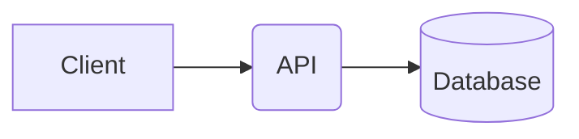
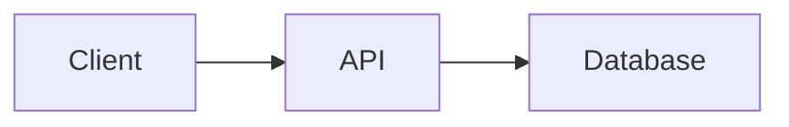

# Text-to-Diagram Tools: A Deep Dive

Text-to-diagram tools translate a textual description of a graph, process, architecture, or relationship into a visual representation. They occupy an interesting intersection of programming languages, graph theory, compilers, document generation, and visual programming.

Tools such as Mermaid, PlantUML, and D2 let developers treat diagrams as source code: they can be edited in a text editor, version-controlled, generated by programs or LLMs, reviewed in diffs, and rendered automatically in documentation pipelines.

The deeper research question is not merely how these tools draw diagrams. It is how a textual language represents visual structure, how much of the diagram's meaning it captures, and how well the language supports reliable programmatic transformation.

## Contents

- [1. The major tools](#1-the-major-tools)
- [2. How text becomes a diagram](#2-how-text-becomes-a-diagram)
- [3. Comparing the language designs](#3-comparing-the-language-designs)
- [4. Where these tools fall short as programming languages](#4-where-these-tools-fall-short-as-programming-languages)
- [5. The deeper language-design trade-offs](#5-the-deeper-language-design-trade-offs)
- [6. The connection to compilers and intermediate representations](#6-the-connection-to-compilers-and-intermediate-representations)
- [7. Bidirectional text–diagram synchronization](#7-bidirectional-textdiagram-synchronization)
- [8. Text-to-diagram tools and AI-friendly syntax](#8-text-to-diagram-tools-and-ai-friendly-syntax)
- [9. Evaluation criteria for research](#9-evaluation-criteria-for-research)
- [10. Further reading and related projects](#10-further-reading-and-related-projects)
- [11. A possible research direction](#11-a-possible-research-direction)

## 1. The major tools

**Mermaid**

**Website:** [mermaid.js.org](https://mermaid.js.org/)

A JavaScript-based diagramming system with concise syntax for flowcharts, sequence diagrams, class diagrams, state diagrams, entity-relationship diagrams, timelines, and more. It is especially well suited to Markdown documentation, wikis, and developer platforms.

**Design emphasis:** easy authoring and convenient embedding in prose.

**PlantUML**

**Website:** [plantuml.com](https://plantuml.com/)

A mature text-driven diagram generator with extensive UML support, including sequence, class, component, deployment, activity, and state diagrams. It also supports non-UML diagrams and integrates with documentation and development workflows.

**Design emphasis:** expressive modeling conventions and established software-engineering diagrams.

**D2**

**Website:** [d2lang.com](https://d2lang.com/)

A declarative diagramming language that emphasizes readable source, styling, nested structures, explicit relationships, and layout control. Its source resembles a small configuration language for describing visual systems.

**Design emphasis:** structured declarations, visual customization, and architecture diagrams.

These tools share a general idea but differ in their language designs. Mermaid provides many specialized diagram grammars; PlantUML often uses diagram-specific directives and modeling conventions; D2 leans toward a more uniform declaration-and-relationship syntax.

Other useful comparison points include Graphviz's DOT language, Structurizr DSL for software architecture, and BPMN-oriented modeling tools. They help reveal which design decisions are general to text-based diagramming and which are specific to a particular tool.

## 2. How text becomes a diagram

The basic architecture resembles a compiler pipeline. A textual source language is parsed into a structured representation, transformed into a graph or diagram model, laid out geometrically, and finally rendered.

1. **Source text** — Identifiers, edges, labels, styles, declarations
2. **Lexing and parsing** — Tokens, grammar rules, syntax validation
3. **Intermediate representation (IR)** — Nodes, edges, attributes, groups, semantic types
4. **Layout engine** — Positions, routing, spacing, hierarchy
5. **Renderer** — SVG, HTML, PNG, or another output format

This is a conceptual architecture rather than an assertion that every tool uses exactly these stages or the same intermediate representation.

### Stage 1: Parsing a domain-specific language

Consider this Mermaid flowchart:



*Diagram source reconstructed from the surrounding description (the original export contained only rendered output).*

The parser needs to recognize several different concepts:

- `flowchart LR` declares the diagram type and direction.
- `A`, `B`, and `C` are stable identifiers within the diagram.
- Brackets and parentheses describe node shapes and labels.
- `-->` represents directed relationships.
- The repeated identifier `B` refers to the same node, rather than creating a new node.

The syntax therefore carries both structural information and presentation hints. Mermaid's official documentation describes the separation between node identifiers, labels, links, shapes, and grouping constructs.

*Source: Mermaid (+1 more)*

### Stage 2: Constructing a graph

A simplified intermediate representation might be:

```json
{
  "kind": "flowchart",
  "direction": "LR",
  "nodes": [
    {
      "id": "A",
      "label": "Client",
      "shape": "rect"
    },
    {
      "id": "B",
      "label": "API",
      "shape": "rect"
    },
    {
      "id": "C",
      "label": "Database",
      "shape": "cylinder"
    }
  ],
  "edges": [
    {
      "from": "A",
      "to": "B",
      "directed": true
    },
    {
      "from": "B",
      "to": "C",
      "directed": true
    }
  ]
}
```

This JSON is an illustrative IR, not Mermaid's actual internal data structure.

The key transformation is that a compact sequence of characters becomes explicit data structures. Once the graph exists independently of the text, other systems can inspect, validate, modify, optimize, or render it.

### Stage 3: Layout and rendering

A graph specifies relationships, but usually not exact coordinates.

The layout engine must decide:

- Which nodes should appear above, below, or beside each other.
- How to minimize overlapping edges and crossings.
- Where labels should sit.
- How nested groups should be sized.
- How to route edges around nodes.
- How to balance compactness against readability.

Mermaid's flowchart documentation, for example, describes layout-engine choices and configuration options.

*Source: Mermaid (+1 more)*

This division is fundamental: the graph defines what is connected; the layout determines how those connections look.

It also explains why the same source can render differently across versions, configuration settings, fonts, or layout engines without changing the underlying graph.

## 3. Comparing the language designs

| Dimension | Mermaid | PlantUML | D2 |
| --- | --- | --- | --- |
| Core style | Diagram-specific textual syntax | Diagram-specific directives and modeling notation | Declarative diagram DSL |
| Common use | Documentation and quick diagrams | UML and software modeling | Architecture and system diagrams |
| Diagram types | Broad collection | Broad collection, especially UML | General diagrams and structured systems |
| Node and edge declarations | Compact, often symbol-driven | Varies by diagram type | Explicit declarations and relationships |
| Visual styling | Themes, classes, directives | Skin parameters, styles, stereotypes | Style properties and configuration |
| Main trade-off | Some syntax is context-sensitive | Different diagram types have distinct conventions | More explicit structure can mean more syntax |

This comparison is qualitative, not a benchmark. Each tool has exceptions and capabilities that extend beyond the generalizations in the table. PlantUML's language reference documents its range of UML and non-UML diagrams, while D2's documentation describes it as a text-based diagram DSL.

*Source: pdf.plantuml.net (+1 more)*

### Example: one graph, three notations

Suppose the intended diagram is a client calling an API, which reads from a database.

### Mermaid



*Diagram source reconstructed from the surrounding description (the original export contained only rendered output).*

Compact, graph-oriented, and easy to embed in Markdown.

### PlantUML

```plantuml
@startuml
[Client] --> [API]
[API] --> database "Database"
@enduml
```

A component-style representation; exact notation and semantics depend on the selected diagram type.

### D2

```text
Client -> API
API -> Database
```

A concise declaration of objects and directed relationships.

These snippets illustrate the styles of the languages rather than guarantee identical rendering or semantics. The PlantUML snippet is schematic; a concrete implementation should be checked against the chosen diagram type and renderer version.

The important observation is that a diagram's abstract meaning is not identical to its source syntax. Several languages can encode similar graphs, but they differ in what they make explicit, what they infer, and how they handle ambiguity.

## 4. Where these tools fall short as programming languages

Text-to-diagram languages are programming languages in a broad sense, but they are usually optimized for describing a visual artifact rather than specifying executable behavior.

This distinction is especially important If the project is researching AI-friendly syntax, bidirectional text–graph synchronization, or visual programming languages.

### 4.1 They often mix semantics and presentation

Consider:

```text
Client -> API
API -> Database
```

This specifies connections, but leaves many questions unanswered:

- Is the connection a network request, a dependency, or a data flow?
- Is the API synchronous or asynchronous?
- Does the database belong to the same deployment environment?
- Are these relationships mandatory, optional, or conditional?

The diagram may be visually correct while remaining semantically incomplete.

A more expressive language might separate these concerns:

```yaml
nodes:
  - id: client
    type: application
  - id: api
    type: service
  - id: database
    type: database

edges:
  - from: client
    to: api
    relation: invokes
    protocol: HTTPS
  - from: api
    to: database
    relation: queries
    protocol: SQL
```

This is illustrative YAML, not a standard diagram format. Its advantage is that relationships become machine-readable facts rather than visual conventions alone.

**Research question:** Should a diagram language define a domain model first and treat appearance as a projection of that model?

### 4.2 Syntax can be ambiguous or fragile

Compact syntax is convenient for humans, but punctuation can have several competing interpretations.

Mermaid's flowchart documentation warns about certain uses of `end` and about identifiers beginning with `o` or `x` adjacent to particular edge operators.

*Source: Mermaid (+1 more)*

These are small examples of a general issue: a language designed around convenient punctuation may become harder to parse, generate, and transform reliably.

Potential consequences include:

- Labels that unexpectedly interact with reserved syntax.
- Escaping rules that vary between contexts.
- Errors caused by seemingly harmless edits.
- LLM-generated source that looks plausible but fails to parse.
- Formatters that must preserve subtle distinctions in the original source.

A robust language should make identifiers, labels, types, and relationships explicit wherever possible, while offering concise shorthand as a convenience.

### 4.3 They usually do not preserve visual intent completely

Suppose a user drags a node to the left of another node. The textual graph might remain exactly the same because the layout engine decides positions automatically.

But what if the user's placement was intentional?

There are at least three distinct kinds of layout intent:

1. **Semantic intent:** A is upstream of B.
2. **Relative visual intent:** A should appear above B.
3. **Geometric intent:** A should be placed at a specific coordinate.

Many text-to-diagram languages primarily capture the first, offer varying support for the second, and may offer limited or specialized support for the third.

This creates a fundamental challenge for bidirectional editing: translating source into a diagram is straightforward in principle, but translating every visual edit back into equivalent source is not.

### 4.4 They are not always composable

In a conventional programming language, developers expect to define reusable functions, modules, types, and libraries.

Diagram languages often provide some combination of grouping, includes, configuration, styles, and reusable declarations, but these mechanisms do not necessarily behave like a coherent programming model.

Consider a shared service represented in five diagrams. Ideally, the service would be defined once, imported wherever needed, and updated consistently.

A diagram language needs to answer:

- Are identifiers local to one diagram or global across modules?
- Can one diagram import another diagram's graph?
- How are name collisions resolved?
- Can a node be extended without redefining it?
- Are dependencies explicit or hidden in configuration?
- Can reusable components have parameters?

These questions become critical when diagrams grow beyond standalone documentation snippets.

### 4.5 Error handling is often designed for rendering, not analysis

A diagram renderer needs to produce a picture. A programming-language toolchain needs more: useful diagnostics, stable source locations, type checking, static analysis, and potentially automated repairs.

For example, a language could distinguish between:

- **A syntax error:** an edge is malformed.
- **A reference error:** an edge refers to a nonexistent node.
- **A semantic error:** a sequence diagram violates a domain constraint.
- **A layout warning:** two labels overlap.
- **A style warning:** a node violates a design convention.

These are different failure classes and should be reported separately.

Graphviz's DOT documentation provides a useful point of comparison because it defines a formal grammar for graph, node, edge, attribute, and subgraph constructs.

*Source: Graphviz (+1 more)*

## 5. The deeper language-design trade-offs

The interesting design space can be summarized along five axes.

**Declarative vs. imperative**

Declarative source says what the diagram contains. Imperative instructions say how to construct or modify it.

**Example:** `A -> B` versus `createNode("A"); createNode("B"); connect("A", "B")`.

**Semantic vs. geometric**

Semantic source describes relationships and domain entities. Geometric source explicitly describes positions, dimensions, and routing.

A useful language needs to decide which layer is authoritative when they conflict.

**Concise vs. explicit**

Short syntax reduces typing and token consumption. Explicit syntax reduces hidden assumptions and can improve diagnostics.

This is especially important when language models generate source automatically.

**Free-form vs. constrained**

Free-form diagrams support expressive layouts. Constrained diagrams can enforce rules, schemas, and organizational conventions.

Constraints can prevent structurally invalid diagrams before rendering.

**Source-authoritative vs. model-authoritative**

A source-authoritative system treats text as the canonical artifact. A model-authoritative system stores a structured graph and generates text as one representation.

The latter can make visual editing and alternate output formats easier, but requires a deliberate serialization and synchronization strategy.

No single choice is universally best. A documentation-oriented tool and a visual programming environment have different requirements.

## 6. The connection to compilers and intermediate representations

One promising architecture is to treat the text format as a front end to a canonical graph model.

- **Front ends:** Text DSL · Visual editor
- **Canonical graph IR** — Stable IDs · typed nodes · typed edges · metadata · constraints
- **Consumers:** Layout engine · Other exporters

The central model would define the diagram independently of any particular syntax or rendering engine.

That enables several capabilities:

- Multiple text front ends for the same model.
- Multiple renderers for the same graph.
- Validation before rendering.
- Structural diffs that ignore irrelevant formatting changes.
- Visual edits that update the underlying model.
- Code generation for other diagram languages.
- Integration with static analysis and AI-assisted editing.

The main difficulty is deciding what belongs in the canonical model. If the model stores only nodes and edges, it may lose layout and source-level details. If it stores every formatting choice, it can become coupled to a particular renderer.

A well-designed IR may therefore separate at least three layers:

| Layer | Responsibility |
| --- | --- |
| Semantic model | Entities, relationships, types, constraints |
| Presentation model | Layout preferences, styles, grouping, visual annotations |
| Source mapping | Original syntax, comments, formatting, source locations |

This is similar in spirit to compiler architectures that distinguish an abstract syntax tree from a lower-level intermediate representation and generated output. It is not necessary for every diagram tool, but it is particularly valuable for editors that must support reliable round-tripping.

## 7. Bidirectional text–diagram synchronization

This is where text-to-diagram tools become especially interesting.

A normal renderer implements a function:

$$
R: S \rightarrow V
$$

where $S$ is source text and $V$ is a visual diagram.

A bidirectional editor needs an additional transformation:

$$
U: (S,V') \rightarrow S'
$$

Here, $V'$ is the diagram after a user edits it visually, and $S'$ is the updated source.

A naïve approach would regenerate all source from the edited graph. But this can destroy comments, whitespace, declaration order, stylistic choices, or syntax that has no direct equivalent in the graph model.

A more robust architecture uses a source-preserving syntax tree and stable identities:

1. Parse source while retaining comments, formatting, and source spans.
2. Construct a semantic graph with stable node and edge IDs.
3. Associate graph objects with their originating syntax nodes.
4. Apply visual edits as graph-model changes.
5. Translate each change into a minimal source patch.
6. Reparse and validate the updated source.
7. Re-render and confirm that the result matches the intended edit.

For example, moving a node might update an explicit position property without rewriting the rest of the file. Adding an edge might insert one declaration near the relevant node rather than reserializing the entire diagram.

However, exact bidirectional synchronization is not always possible. If the original language does not represent a visual property, the editor must either extend the language, store supplementary metadata, or accept that the edit cannot be preserved.

This is closely related to bidirectional transformations, lenses, incremental compilers, and concrete syntax tree tooling.

## 8. Text-to-diagram tools and AI-friendly syntax

LLMs introduce a different set of design requirements. They are good at generating familiar textual patterns, but can make subtle syntax errors or invent unsupported constructs.

A diagram DSL designed for reliable AI generation could prioritize the following.

| Design feature | Why it helps |
| --- | --- |
| Explicit declarations | Makes entities and their types easier to identify |
| Stable IDs | Prevents accidental renaming and duplicate nodes |
| Uniform syntax | Reduces the number of special cases a model must learn |
| Clear escaping rules | Prevents labels from interfering with grammar |
| Schema validation | Detects invalid node types and relationships |
| Structured diagnostics | Enables targeted repair rather than full regeneration |
| Canonical formatting | Makes generated changes easier to review |
| Incremental editing | Allows a model to change one relationship without rewriting the whole diagram |
| Deterministic serialization | Reduces noisy diffs and inconsistent outputs |

One particularly useful approach is to separate graph generation from visual styling.

An AI system could first generate a typed graph, validate its structure, and only then choose a layout and theme. This reduces the number of decisions the model must make simultaneously.

Another approach is to provide a constrained editing API: rather than asking the model to rewrite the whole diagram, ask it to perform operations such as `add_node`, `add_edge`, `rename_node`, or `set_style`.

The latter approach also makes it easier to validate proposed changes before applying them.

## 9. Evaluation criteria for research

To compare text-to-diagram languages rigorously, it helps to define measurable criteria rather than relying exclusively on syntax aesthetics.

1. **Expressiveness** — Can the language represent the intended graph, relationships, grouping, layout, and domain semantics?
2. **Syntactic reliability** — How often do humans or LLMs produce valid source, and how easy are errors to diagnose?
3. **Round-trip fidelity** — Can source be parsed and re-emitted without losing semantics, formatting, comments, or visual intent?
4. **Edit locality** — Does changing one node or edge require rewriting unrelated source?
5. **Determinism** — Does the same source and configuration yield stable output across repeated renders?
6. **Incremental performance** — Can large diagrams be reparsed, validated, and rendered efficiently after small changes?
7. **Interoperability** — Can the graph be converted to other diagram languages or a canonical graph representation?
8. **AI generation quality** — How many attempts are needed to produce a valid, semantically correct diagram under a fixed task set?

For a serious experiment, use the same collection of diagram tasks across languages. Measure parse success, semantic correctness, source size, editing effort, render stability, and repair cost. Test both human-written and LLM-generated source, since a language that is elegant for experts may not be the easiest for a model to generate reliably.

## 10. Further reading and related projects

- **Graphviz DOT** A useful baseline for studying explicit graph declarations, attributes, subgraphs, and formal grammar. [DOT language reference](https://graphviz.org/doc/info/lang.html)
- **Graphviz** — *Structurizr DSL.* Worth investigating when diagrams should be views of a shared architecture model instead of independent drawings. [DSL documentation](https://docs.structurizr.com/dsl)
- **PlantUML sequence diagrams** Particularly useful for examining how a domain-specific grammar represents interactions, ordering, conditional branches, and parallel behavior. [Sequence diagram reference](https://plantuml.com/sequence-diagram)
- **PlantUML.com** — *D2 connections and object declarations.* Useful for studying how identifiers, labels, nested objects, and edges can be expressed in a declarative DSL. [Connections reference](https://d2lang.com/tour/connections)

D2 Documentation

## 11. A possible research direction

A promising research project would be to design a round-trip-safe, AI-friendly diagram language that combines the advantages of compact textual syntax with the structure of a typed graph model.

A reasonable prototype could have these components:

1. A small core grammar with explicit node declarations, typed edges, stable identifiers, and nested groups.
2. A canonical graph IR independent of the source language and renderer.
3. A source-preserving parser that retains comments, whitespace, and source locations.
4. A visual editor that edits the same graph model rather than maintaining a separate representation.
5. Incremental synchronization that generates minimal text patches after visual edits.
6. A validation layer that checks references, types, domain constraints, and layout rules.
7. An LLM editing interface that proposes structured graph operations and receives precise validation errors.

The prototype could then be compared against Mermaid, PlantUML, and D2 using tasks such as adding a node, changing a relationship, moving a node, refactoring a group, and converting a diagram to another syntax.

The central hypothesis would be that a diagram language becomes substantially more useful as a programming interface when its textual syntax, semantic graph, and visual representation are separate but explicitly synchronized layers.

That hypothesis is testable: measure whether the architecture improves source preservation, edit locality, AI generation success, and consistency between text and visual edits.
